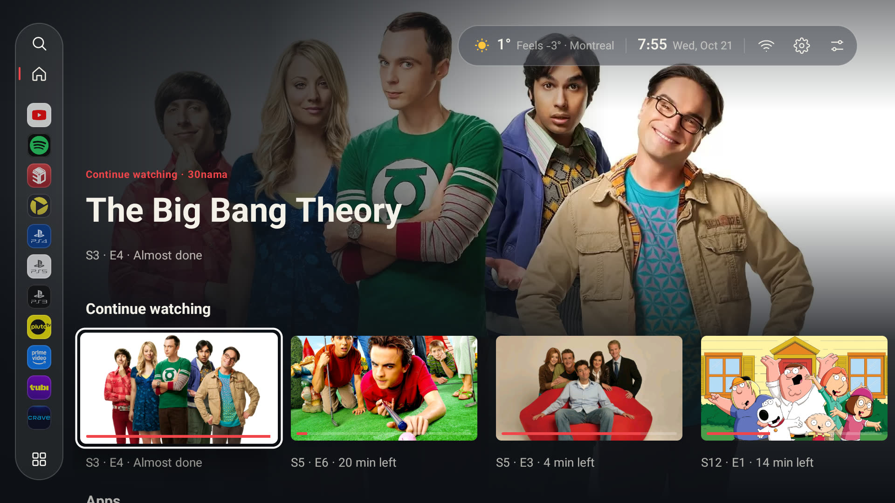
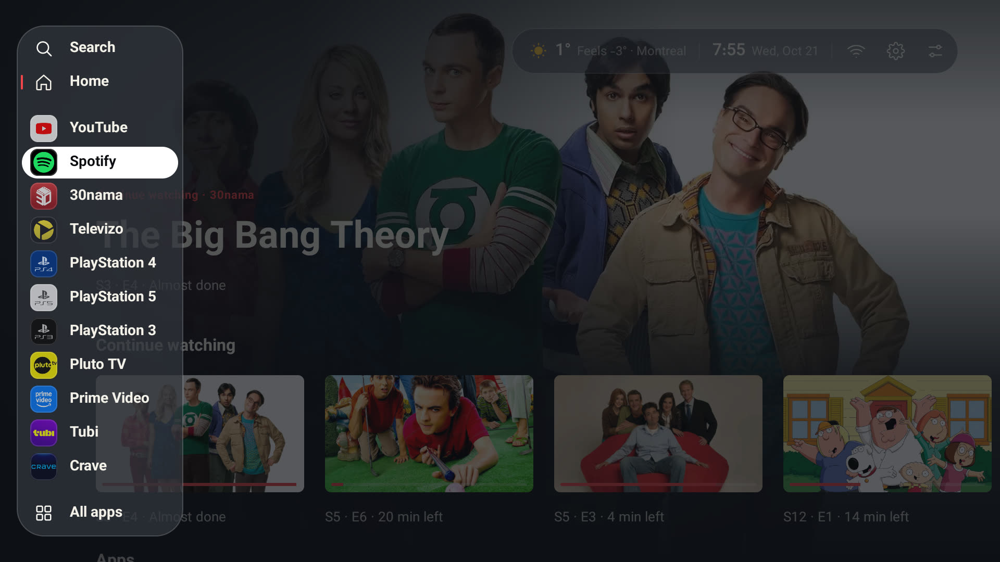
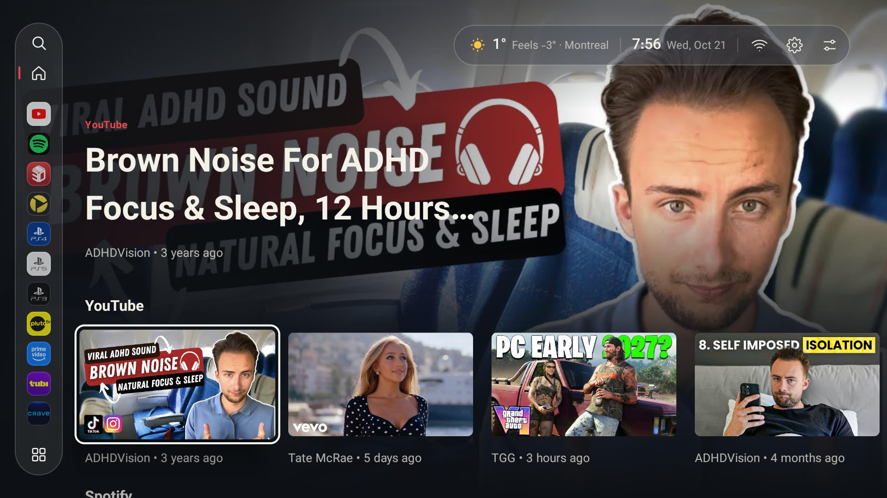
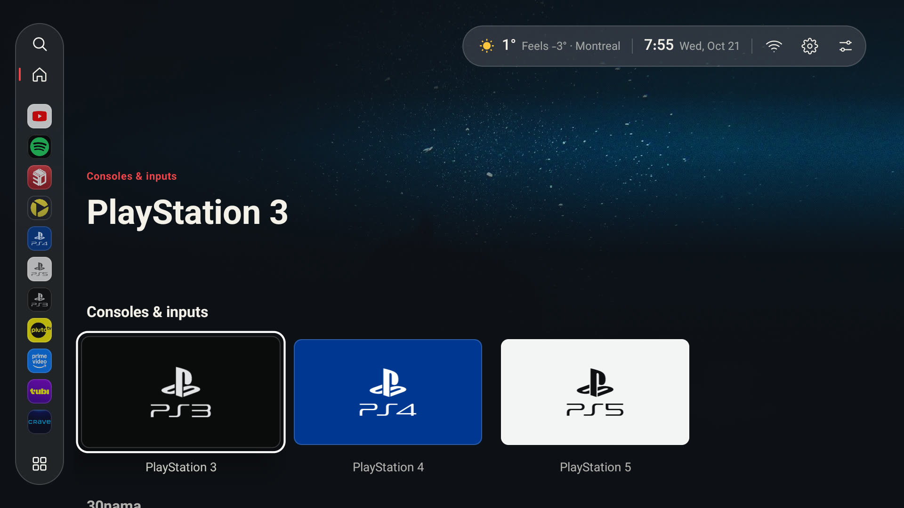
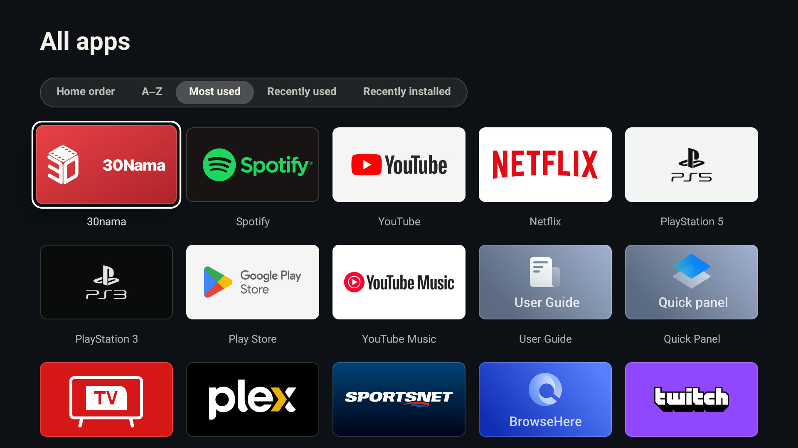
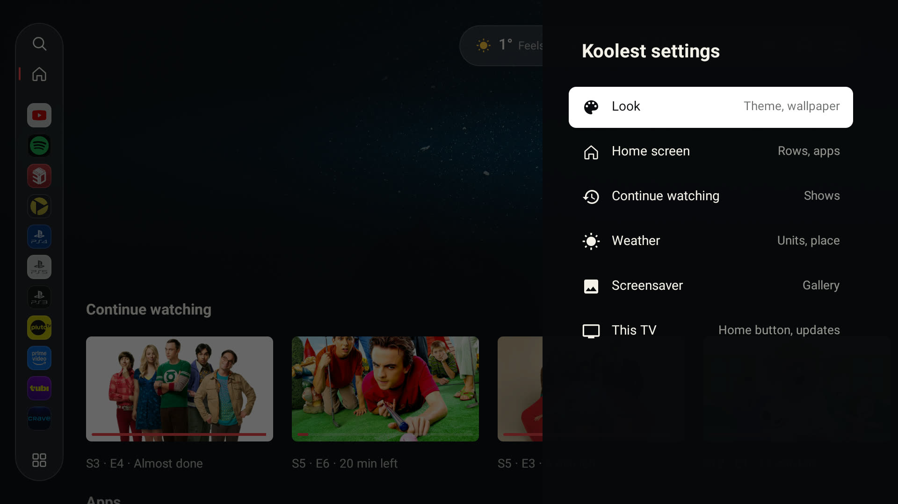

<h1 align="center">Koolest TV Launcher</h1>

<p align="center">
  A fast, ad-free home screen for Android TV and Google TV, in the look of the 30nama TV app.
</p>

<p align="center">
  <a href="https://github.com/benymaxparsa/Koolest-TV-Launcher/releases/latest"></a>
  
  
  <a href="LICENSE"></a>
</p>

<p align="center">
  
</p>

Koolest replaces the stock home screen with what you actually use: your apps, your consoles and what's on in them. There are no ads, no sponsored rows, no account and no tracking. It's a single small APK with no third-party libraries.

## Highlights

- **30nama TV layout.** A menu on the left edge, a large billboard for whatever is focused, and rows of landscape cards below it, set in Vazirmatn with a white focus ring.
- **Rows, top to bottom:** Continue watching, Apps, Consoles & inputs, 30nama, YouTube and Spotify, then a row for every other app that publishes to the TV's home screen (Netflix, Prime Video, Tubi, Apple TV, Twitch…). Rows with nothing in them don't show, and any row can be turned off.
- **Continue watching that works.** Everything apps report as partway watched, from Android TV's Watch Next list and apps' own "Continue watching" channels. The apps you use most come first, and browsers' open tabs stay out.
- **Consoles and inputs.** Devices that name themselves over HDMI-CEC get a tile with their own mark: PlayStation 3/4/5, Xbox, Switch, Steam Deck, Apple TV, Shield, Chromecast and more. Selecting one switches the TV to that input.
- **Glass design, iOS style.** The menu floats in a frosted glass capsule and opens into a glass card; the clock, weather and buttons share one capsule on a single line.
- **A taskbar menu.** Search, Home, your pinned apps and consoles, then All apps, in three groups. Add, remove and reorder the pins in settings.
- **All apps, sorted your way.** Home order, A–Z, most used, recently used or recently installed, picked from an iOS-style segmented control.
- **Motion.** Focused cards grow and lift, rows glide into place and the background crossfades to the focused item's art. A row starts over from its first item each time you come back to it.
- **Simple settings.** Six groups: Look, Home screen, Continue watching, Weather, Screensaver, and Koolest and this TV.
- **Home button support on Google TV.** The Home button opens Koolest even where the system launcher can't be replaced. Holding Home still opens the Google TV dashboard.
- **Clock and weather** in the top corner: the time and date, and (if you turn it on) the weather with its icon, "feels like" and your city.
- **Smooth on TV hardware.** Pictures load just ahead of where you're browsing, the billboard art cross-fades at full screen size, and the home screen draws as few full-screen layers as it can.
- **Extras:** light, dark or automatic theme with your own wallpapers (upload from your phone by QR code) or changing Unsplash photos, a Gallery screensaver and a PIN lock for the layout.

## Screenshots

<table>
  <tr>
    <td width="50%"><br><sub>The menu opens into a glass card, in three groups.</sub></td>
    <td width="50%"><br><sub>Every row fills the billboard with the focused item's art.</sub></td>
  </tr>
  <tr>
    <td><br><sub>Consoles on HDMI, over a changing Unsplash wallpaper.</sub></td>
    <td><br><sub>All apps, sorted from a segmented control.</sub></td>
  </tr>
  <tr>
    <td><br><sub>Settings in six groups.</sub></td>
    <td></td>
  </tr>
</table>

## Requirements

- Android TV or Google TV running **Android 8.0 (Oreo) or newer**
- A way to sideload an APK: the *Downloader* app, a USB drive with a file manager, or `adb`

## Installation

1. Download the latest APK from the [Releases](https://github.com/benymaxparsa/Koolest-TV-Launcher/releases/latest) page, or build it yourself (below).
2. Install it on your TV:
   - **USB drive:** copy the APK over and open it with a file manager.
   - **adb:** `adb install Koolest.apk`
3. Open **Koolest TV Launcher** from your apps. Its settings open automatically on first launch.

### First-run setup

In **Koolest settings → This TV**:

| Setting | What to do |
|---|---|
| **Home button** | Press OK. In the Accessibility screen that opens, select **Koolest: Home button** and turn it on. |
| **Default home** | Press OK and choose **Koolest TV Launcher** in the dialog. (Google TV keeps its own launcher as the default, which is what the Home button setting works around.) |

Allow the **TV listings** permission when asked; the content rows and Continue watching need it.

> [!NOTE]
> Android shows the same generic warning for every accessibility service. Koolest's service only listens for the Home key and for the system launcher appearing. It cannot read screen content.

> [!TIP]
> **Android 13 and newer:** Android blocks sideloaded apps from Accessibility at first. Open **Settings → Apps → Koolest TV Launcher**, choose **Allow restricted settings** from the menu, then turn the service on.

### Recommended: keep the Home button working (adb)

```sh
adb shell pm grant dev.koolest android.permission.WRITE_SECURE_SETTINGS
adb shell appops set dev.koolest APP_AUTO_START allow   # TCL TVs
```

Android only starts the Home button service when its setting changes. After a reboot, an update, or the TV closing Koolest in the background (TCL TVs do this while a console is on), Home would land on Google TV again. With the first permission, Koolest switches its service back on by itself: at boot, after an update, every 15 minutes and whenever it opens. It also lets Koolest set the Gallery screensaver. The second line is for TCL TVs, whose own "auto start" guard otherwise stops Android from starting the service and from telling Koolest the TV has booted.

## Using Koolest

| Action | How |
|---|---|
| Turn home rows on or off | **Settings → Home screen → Rows** |
| Pin, remove or reorder apps in the menu | **Settings → Home screen → Menu apps** |
| Rearrange the Apps row | Hold **OK** on an app, or **Settings → Home screen → Rearrange apps** |
| Hide a Continue watching item | Hold **OK** on its card |
| Choose which apps feed Continue watching | **Settings → Continue watching → Apps** |
| Sort All apps | Open **All apps** and pick a sort at the top |
| Change theme or wallpaper | **Settings → Look** |
| Lock the layout with a PIN | **Settings → This TV → PIN lock** |
| Back on the home screen | From deep in a row, back to its first item; again, to the menu; again, back to the rows |
| Open the Google TV dashboard | Hold the **Home** button |

### Why some apps aren't in Continue watching

Koolest can only show what apps report to Android TV. Google TV's own Continue watching row also uses your Google account's history, which other apps can't read. If an app's shows don't appear here, that app doesn't report them to the TV.

### Why only one YouTube account?

YouTube publishes its home-screen rows (Recommended, Subscriptions, Trending and so on) for the account that's active in the YouTube app only, and offers no way for other apps to read another account's recommendations. Switch accounts in YouTube and Koolest's YouTube row follows.

### Custom wallpapers

In **Settings → Look**, open a theme's wallpaper and choose **Add from phone…**. Scan the QR code with your phone (on the same Wi-Fi as the TV) and upload a photo. You can also copy `.jpg`, `.png` or `.webp` files into the app's folder:

```sh
adb push my-wallpaper.jpg /sdcard/Android/data/dev.koolest/files/wallpapers/
```

### Changing photos from Unsplash

Choose **Unsplash photos** as a theme's wallpaper and a new photo arrives on the schedule set in **Settings → Look → Photo changes** (every minute to once a day). Photos come at your TV's resolution from [Lorem Picsum](https://picsum.photos), which serves random photos from [Unsplash](https://unsplash.com). Offline, the last photo stays up.

## Privacy

Koolest has no analytics, no ads and no account. It only connects to the internet to:
- load artwork for the cards on the home screen
- check this repository's GitHub releases for a new version, once a day, and download it when you choose to update
- download the Gallery paintings from this repository, **only if you choose that screensaver**
- download a wallpaper photo from [Lorem Picsum](https://picsum.photos), **only if you choose Unsplash photos**
- fetch the weather, **only if you turn it on**, via [ipwho.is](https://ipwho.is) (approximate location from your IP) and [Open-Meteo](https://open-meteo.com)

**Add from phone…** runs a small upload page on the TV itself, reachable only on your home network and only while that screen is open.

## Building from source

```sh
git clone https://github.com/benymaxparsa/Koolest-TV-Launcher.git
cd Koolest-TV-Launcher
./gradlew testDebugUnitTest assembleRelease
```

The APK is written to `app/build/outputs/apk/release/`. Without a `keystore.properties` file, release builds are signed with your local debug key, which is fine for installing your own build.


## Credits

- Based on [Plume Launcher](https://github.com/aradhyas8/Plume_Launcher) by aradhyas8 (GPL-3.0).
- Design language from the 30nama TV app.
- **Font:** [Vazirmatn](https://github.com/rastikerdar/vazirmatn) by Saber Rastikerdar (SIL Open Font License 1.1).
- **Logos:** [Simple Icons](https://simpleicons.org) (CC0) and [Material Symbols](https://fonts.google.com/icons) (Apache 2.0). All trademarks belong to their respective owners.
- **Screensaver paintings** (public domain, via Wikimedia Commons; files in [`screensaver/`](screensaver)): Frederic Edwin Church, Ivan Shishkin, Jasper Francis Cropsey and Martin Johnson Heade.
- **Wallpaper:** "Canada" by Thomas Curryer, via [Unsplash](https://unsplash.com/@tawc20).
- **Changing wallpapers:** photos by Unsplash photographers, served by [Lorem Picsum](https://picsum.photos).

## License

Copyright (C) 2026 aradhyas8 (Plume Launcher)
Copyright (C) 2026 Parsa Kamalipour (Koolest TV Launcher)

Koolest TV Launcher is free software, released under the [GNU General Public License v3.0](LICENSE). Any distributed version, modified or not, must also be released under the GPL-3.0 with its full source code.
