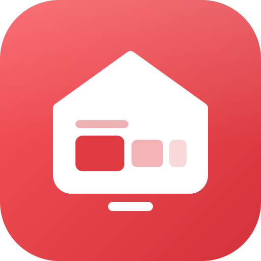
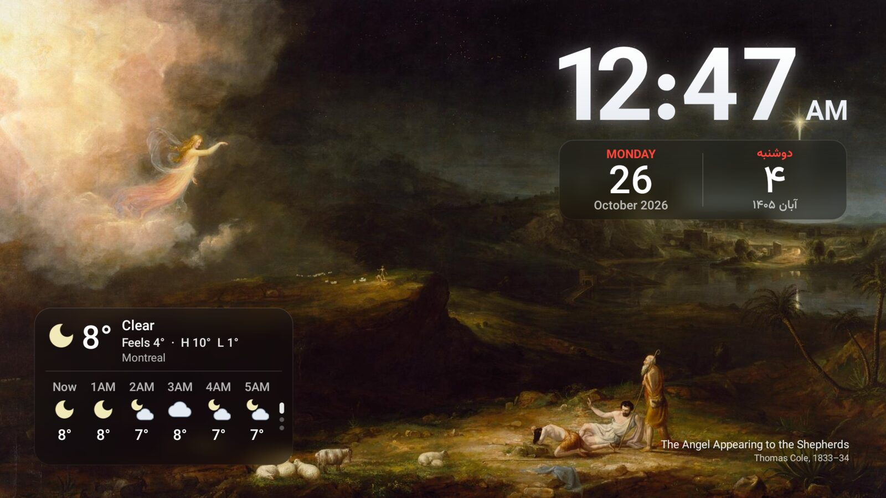

<p align="center"></p>

<h1 align="center">Koolest TV Launcher</h1>

<p align="center">
  A fast, ad-free home screen for Android TV and Google TV on any brand, in the look of Glass design, iOS style app. In English, French and Persian.
</p>

<p align="center">
  <a href="https://github.com/KoolestTVLauncher/Koolest-TV-Launcher/releases/latest"></a>
  
  
  <a href="LICENSE"></a>
</p>

<p align="center">
  <a href="https://koolesttvlauncher.github.io"><b>Website</b></a>: a tour, a demo video and the setup guide.
</p>

<p align="center">
  
</p>

Koolest replaces the stock home screen with what you actually use: your apps, your consoles and what's on in them. There are no ads, no sponsored rows, no account and no tracking. It's a single small APK with no third-party libraries.

## Highlights

- **30nama TV layout.** A menu on the left edge, a large billboard for whatever is focused, and rows of landscape cards below it, set in Vazirmatn with a white focus ring.
- **Rows, top to bottom:** Continue watching, Apps, Consoles & inputs, 30nama, YouTube and Spotify, then a row for every other app that publishes to the TV's home screen (Netflix, Prime Video, Tubi, Apple TV, Twitch…). Rows with nothing in them don't show, and any row can be turned off.
- **Continue watching that works.** Everything apps report as partway watched, from Android TV's Watch Next list and apps' own "Continue watching" channels. The apps you use most come first, and browsers' open tabs stay out.
- **Consoles and inputs.** Devices that name themselves over HDMI-CEC get a tile with their own mark: PlayStation 3/4/5, Xbox, Switch, Steam Deck, Apple TV, Shield, Chromecast and more. Selecting one switches the TV to that input.
- **Liquid Glass design, iOS 26 style.** The menu, the top bar and settings are glass edged with light; settings opens as a floating card from its button while the home screen blurs behind it, and a focused poster catches a sweep of light as on Apple TV. Light mode is a soft white that doesn't glare in a dark room, with glass panes lifted on soft shadows.
- **A taskbar menu.** Search, Home, your pinned apps and consoles, then All apps, in three groups. Add, remove and reorder the pins in settings.
- **All apps, sorted your way.** Home order, A–Z, most used, recently used or recently installed, picked from an iOS-style segmented control.
- **English, French and Persian.** Persian lays the whole home screen out right to left. Follow the TV's language or pick one in **Settings → Look → Language**; app names and inputs follow it too, using each app's own translation and the names you gave your inputs in the TV's settings.
- **Any Android TV brand.** Google TV and Android TV from any maker, Android 8 to Android 16. Koolest works around whichever launcher the TV ships, not only Google TV's.
- **Motion.** Focused cards grow and lift, rows glide into place and the background crossfades to the focused item's art. A row starts over from its first item each time you come back to it.
- **Simple settings.** Six groups: Look, Home screen, Continue watching, Weather, Screensaver and This TV.
- **Home button support on every TV.** The Home button opens Koolest even where the TV's own launcher can't be replaced, as on Google TV and most Android TVs. On Google TV, holding Home still opens the dashboard.
- **Setup without a computer.** **Keep Home working** and **Only launcher** in Settings → This TV do the adb steps from the remote, through the TV's own network debugging. Only launcher switches the TV's own home screen off (whichever one the TV ships) so Koolest is the only one; switch it off to bring it back.
- **Now playing in the top bar.** While music plays, the cover, title and artist sit in the top capsule, like a Live Activity in the Dynamic Island (Settings → Home screen → Now playing).
- **Persian (Shamsi) date in the top bar**, beside the other date or instead of it (Settings → Home screen → Top bar date).
- **Rows your way.** Turn any row off, or move it up or down (Settings → Home screen → Rows). Items sliding off a row fade out as they pass under the menu.
- **Clock and weather** in the top corner: the time and date, and (if you turn it on) the weather with its icon, "feels like" and your city.
- **Smooth on TV hardware.** Pictures load just ahead of where you're browsing, the billboard art cross-fades at full screen size, and the home screen draws as few full-screen layers as it can.
- **A glass screensaver.** Gallery shows paintings or your photos under a glass clock and calendar tiles in the top corner, with Gregorian, Persian (Shamsi) or both dates, in a tile each or together in one (Settings → Screensaver → Dates). If the weather is on, one glass card shows it now (with feels like), then a stack that turns every few seconds (▲ ▼ on the remote) between the next hours, five days, and humidity, wind, rain, UV, air quality and the next sunrise or sunset. While music plays, a Now Playing card shows the cover, title and progress (Settings → Screensaver → Music). Pick when it starts and how long it runs before the TV sleeps (Settings → Screensaver → Starts after, TV sleeps after).
- **Extras:** light, dark or automatic theme with your own wallpapers (upload from your phone by QR code) or changing Unsplash photos, and a PIN lock for the layout.

## Screenshots



<table>
  <tr>
    <td width="50%"><br><sub>The menu opens into a glass card, in three groups.</sub></td>
    <td width="50%"><br><sub>Every row fills the billboard with the focused item's art.</sub></td>
  </tr>
  <tr>
    <td><br><sub>Consoles on HDMI, over a changing Unsplash wallpaper.</sub></td>
    <td><br><sub>All apps, sorted from a segmented control.</sub></td>
  </tr>
  <tr>
    <td><br><sub>Settings in six groups.</sub></td>
    <td></td>
  </tr>
</table>

## Requirements

- Android TV or Google TV running **Android 8.0 (Oreo) to Android 16**, from any brand
- A way to sideload an APK: the *Downloader* app, a USB drive with a file manager, or `adb`

## Installation

1. Download the latest APK from the [Releases](https://github.com/KoolestTVLauncher/Koolest-TV-Launcher/releases/latest) page, or build it yourself (below).
2. Install it on your TV:
   - **Downloader app:** open it on the TV and type `koolesttvlauncher.github.io/get`.
   - **USB drive:** copy the APK over and open it with a file manager.
   - **adb:** `adb install Koolest.apk`
3. Open **Koolest TV Launcher** from your apps. Its settings open automatically on first launch.

Koolest checks GitHub for a new version once a day (**Settings → This TV → Updates**) and installs it when you choose. Releases from 2.0.0 are signed with a release key. If you have an older build that was signed with a debug key, or one you built yourself, uninstall it once first: Android won't update across different signing keys.

### First-run setup

In **Koolest settings → This TV**:

| Setting | What to do |
|---|---|
| **Home button** | Press OK. In the Accessibility screen that opens, select **Koolest: Home button** and turn it on. |
| **Default home** | Press OK and choose **Koolest TV Launcher** in the dialog (on Android 8 and 9, press Home and pick Koolest with **Always**). The row says whether Home really lands on Koolest. On Google TV and many Android TVs, the TV's own launcher always gets Home first whatever the default; Koolest tells you so, and the Home button setting works around it. |

Allow the **TV listings** permission when asked; the content rows and Continue watching need it.

> [!NOTE]
> Android shows the same generic warning for every accessibility service. Koolest's service only listens for the Home key and for the system launcher appearing. It cannot read screen content.

> [!TIP]
> **Android 13 and newer:** Android blocks sideloaded apps from Accessibility at first. Open **Settings → Apps → Koolest TV Launcher**, choose **Allow restricted settings** from the menu, then turn the service on.

### Recommended: keep the Home button working (adb)

No computer? In **Settings → This TV**, choose **Keep Home working**. Koolest runs these lines itself through the TV's network debugging: turn on Developer options and USB debugging first (Koolest shows how), then choose **Allow** when the TV asks. You can turn debugging off again afterwards. From a computer:

```sh
adb shell pm grant dev.koolest android.permission.WRITE_SECURE_SETTINGS
adb shell appops set dev.koolest APP_AUTO_START allow   # TCL TVs
```

Android only starts the Home button service when its setting changes. After a reboot, an update, or the TV closing Koolest in the background (TCL TVs do this while a console is on), Home would land on the TV's own launcher again. With the first permission, Koolest switches its service back on by itself: at boot, after an update, every 15 minutes and whenever it opens. It also lets Koolest set the Gallery screensaver. The second line is for TCL TVs, whose own "auto start" guard otherwise stops Android from starting the service and from telling Koolest the TV has booted.

### Optional: make Koolest the only launcher (adb)

On Google TV and most Android TVs, the TV's own launcher always outranks Koolest as the default home. To have Koolest be the only one, turn off every other home screen. On the TV, switch on **Settings → This TV → Only launcher** (same debugging steps as above; switch it off to undo): it finds whichever launchers the TV has and turns them off. From a computer, on Google TV that's the launcher and its setup screen, which otherwise takes over Home:

```sh
adb shell pm disable-user --user 0 com.google.android.apps.tv.launcherx
adb shell pm disable-user --user 0 com.google.android.tungsten.setupwraith
```

Wait about 15 seconds before rebooting, or Android may not have saved the change yet. Nothing is uninstalled. Holding Home no longer opens the Google TV dashboard, and its quick-settings panel and profiles go away with it; the full Settings app still works. To undo, run the same lines with `pm enable <package>`. On other brands, `adb shell cmd package query-activities --brief -a android.intent.action.MAIN -c android.intent.category.HOME` lists the home screens to turn off; leave `com.android.tv.settings` on, it's Android's fallback home. A factory reset or a system update may turn the TV's launcher back on.

## Using Koolest

| Action | How |
|---|---|
| Turn home rows on or off | **Settings → Home screen → Rows** |
| Pin, remove or reorder apps in the menu | **Settings → Home screen → Menu apps** |
| Rearrange the Apps row | Hold **OK** on an app, or **Settings → Home screen → Rearrange apps** |
| Hide a Continue watching item | Hold **OK** on its card |
| Choose which apps feed Continue watching | **Settings → Continue watching → Apps** |
| Sort All apps | Open **All apps** and pick a sort at the top |
| Change theme or wallpaper | **Settings → Look** |
| Change the language | **Settings → Look → Language** (English, Français, فارسی, or the TV's) |
| Lock the layout with a PIN | **Settings → This TV → PIN lock** |
| Back on the home screen | From deep in a row, back to its first item; again, to the menu; again, back to the rows |
| Open the Google TV dashboard | Hold the **Home** button (not if Google TV is [turned off](#optional-make-koolest-the-only-launcher-adb)) |

## Troubleshooting

| Problem | Fix |
|---|---|
| Home opens the TV's own launcher after a reboot, an update or a console session | Run the two `adb` lines under [Recommended](#recommended-keep-the-home-button-working-adb), then switch **Home button** off and on in **Settings → This TV**. |
| Home button setting won't turn on (Android 13+) | **Settings → Apps → Koolest TV Launcher → ⋮ → Allow restricted settings**, then try again. |
| Rows or Continue watching are empty | Allow the **TV listings** permission. Then see the notes below: an app only shows up if it reports to the TV. |
| Screensaver won't switch | Grant `WRITE_SECURE_SETTINGS` over `adb` (above); Android doesn't let apps set the screensaver otherwise. |

### Why some apps aren't in Continue watching

Koolest can only show what apps report to Android TV. Google TV's own Continue watching row also uses your Google account's history, which other apps can't read. If an app's shows don't appear here, that app doesn't report them to the TV.

### Why only one YouTube account?

YouTube publishes its home-screen rows (Recommended, Subscriptions, Trending and so on) for the account that's active in the YouTube app only, and offers no way for other apps to read another account's recommendations. Switch accounts in YouTube and Koolest's YouTube row follows.

### Custom wallpapers

In **Settings → Look**, open a theme's wallpaper and choose **Add from phone…**. Scan the QR code with your phone (on the same Wi-Fi as the TV) and upload a photo. You can also copy `.jpg`, `.png` or `.webp` files into the app's folder:

```sh
adb push my-wallpaper.jpg /sdcard/Android/data/dev.koolest/files/wallpapers/
```

### Changing photos from Unsplash

Choose **Unsplash photos** as a theme's wallpaper and a new photo arrives on the schedule set in **Settings → Look → Photo changes** (every minute to once a day). Photos come at your TV's resolution from [Lorem Picsum](https://picsum.photos), which serves random photos from [Unsplash](https://unsplash.com). Offline, the last photo stays up.

## Privacy

Koolest has no analytics, no ads and no account. It only connects to the internet to:
- load artwork for the cards on the home screen
- check this repository's GitHub releases for a new version, once a day, and download it when you choose to update
- download the Gallery paintings from this repository, **only if you choose that screensaver**
- download a wallpaper photo from [Lorem Picsum](https://picsum.photos), **only if you choose Unsplash photos**
- fetch the weather, **only if you turn it on**, via [ipwho.is](https://ipwho.is) (approximate location from your IP) and [Open-Meteo](https://open-meteo.com)

**Music** in the screensaver settings switches on notification access for Koolest. Android only shares what's playing with apps that have it; Koolest reads the playing track and nothing else. Like **Keep Home working**, it goes through the TV's network debugging; from a computer it's `adb shell cmd notification allow_listener dev.koolest/dev.koolest.MediaListener`.

**Add from phone…** runs a small upload page on the TV itself, reachable only on your home network and only while that screen is open.

## Building from source

```sh
git clone https://github.com/KoolestTVLauncher/Koolest-TV-Launcher.git
cd Koolest-TV-Launcher
./gradlew testSideloadDebugUnitTest assembleSideloadRelease
```

The APK is written to `app/build/outputs/apk/sideload/release/`. There are two flavors: `sideload` is the GitHub APK, and `play` (`assemblePlayRelease`) leaves out the adb shortcuts in `app/src/sideload`, which Google Play doesn't allow. Without a `keystore.properties` file (git-ignored; it holds `storeFile`, `storePassword`, `keyAlias` and `keyPassword`), release builds are signed with your local debug key, which is fine for installing your own build. Unit tests live in `app/src/test` and `app/src/testSideload`.

## Credits

- Based on [Plume Launcher](https://github.com/aradhyas8/Plume_Launcher) by aradhyas8 (GPL-3.0).
- Design language from the 30nama TV app.
- **Font:** [Vazirmatn](https://github.com/rastikerdar/vazirmatn) by Saber Rastikerdar (SIL Open Font License 1.1).
- **Logos:** [Simple Icons](https://simpleicons.org) (CC0) and [Material Symbols](https://fonts.google.com/icons) (Apache 2.0). All trademarks belong to their respective owners.
- **Screensaver paintings** (public domain, via Wikimedia Commons; files in [`screensaver/`](screensaver)): Frederic Edwin Church, Ivan Shishkin, Jasper Francis Cropsey, Martin Johnson Heade, Albert Bierstadt, Thomas Moran, Thomas Cole, Sanford Robinson Gifford, John Frederick Kensett, William Bradford and Arkhip Kuindzhi.
- **Wallpaper:** "Canada" by Thomas Curryer, via [Unsplash](https://unsplash.com/@tawc20).
- **Changing wallpapers:** photos by Unsplash photographers, served by [Lorem Picsum](https://picsum.photos).

## Support

Koolest is free, with no ads and no tracking, and stays that way. If it makes your TV nicer to use, you can support its development through [GitHub Sponsors](https://github.com/sponsors/benymaxparsa) or [Buy Me a Coffee](https://buymeacoffee.com/parsakamalipour). Starring the repo and telling a friend help just as much.

## License

Copyright (C) 2026 aradhyas8 (Plume Launcher)
Copyright (C) 2026 Parsa Kamalipour (Koolest TV Launcher)

Koolest TV Launcher is free software, released under the [GNU General Public License v3.0](LICENSE). Any distributed version, modified or not, must also be released under the GPL-3.0 with its full source code.
